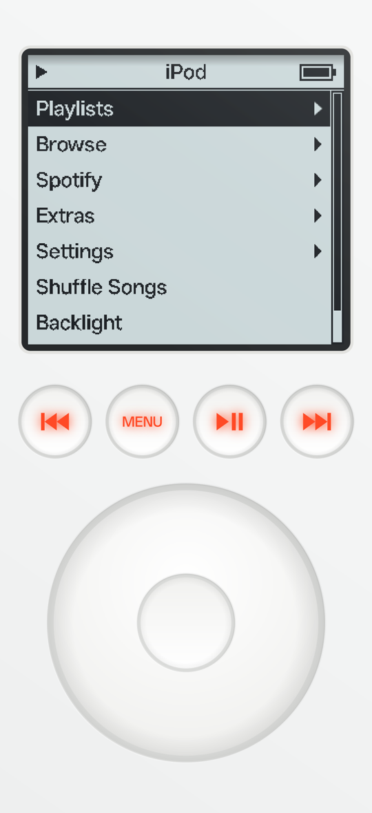
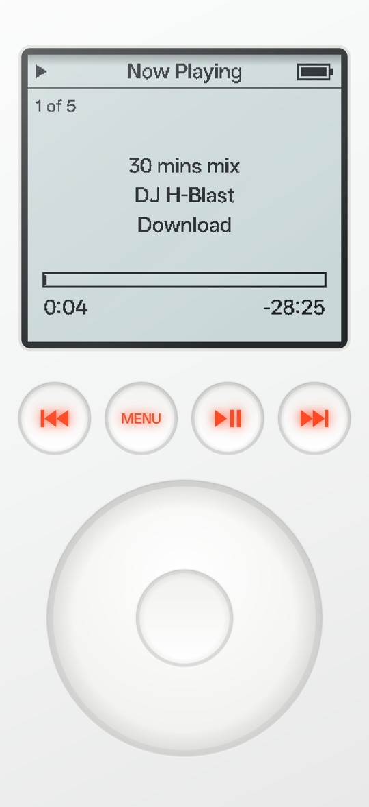
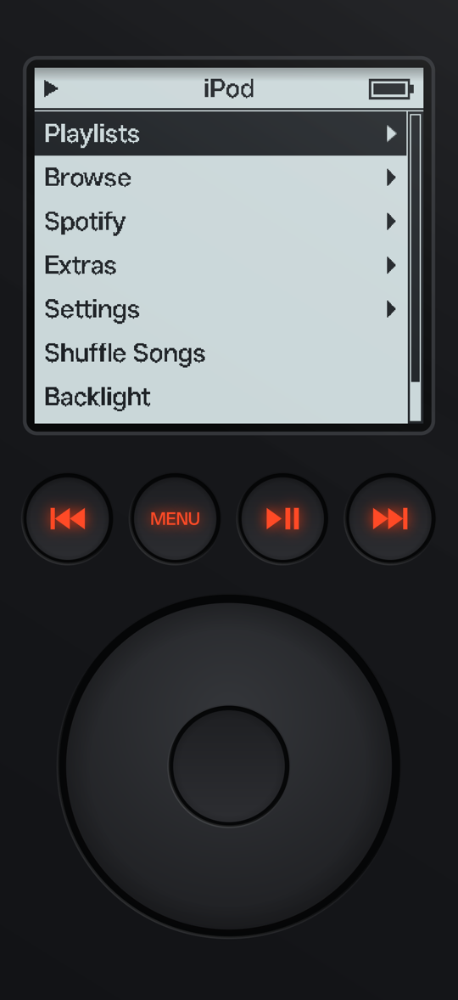
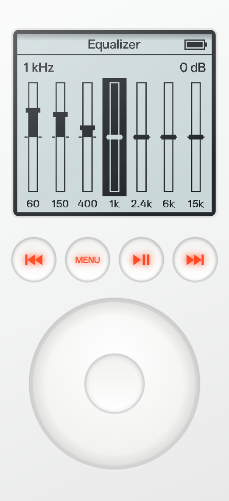
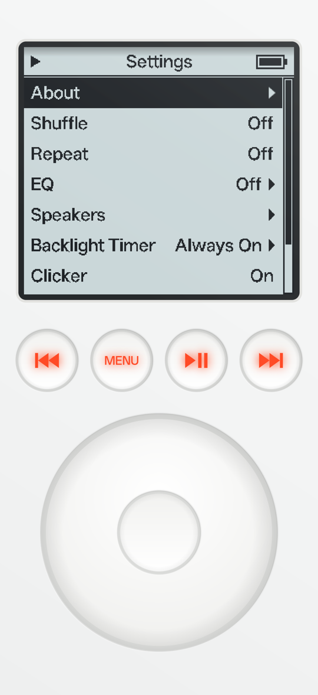
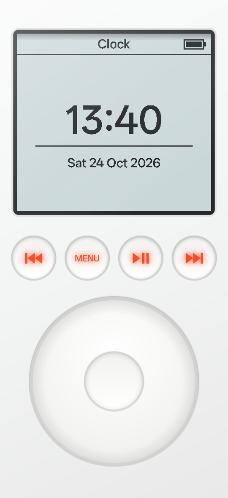
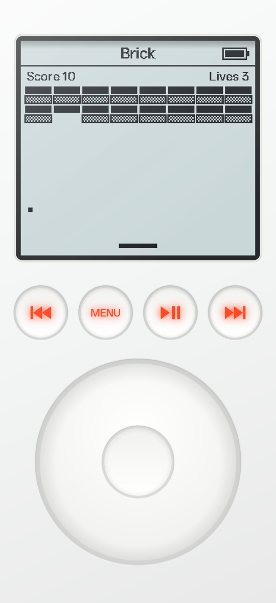

# iPod 3G Player

*Serene listening, the way it used to feel.*

An Android music player that looks and works like the 3rd generation iPod from 2003: the grey-blue
LCD with its pixel font, the four red-lit buttons and the touch wheel, all under a clear acrylic
layer. It plays the music on your phone, and your Spotify library if you connect it. You can send
it to Sonos speakers, a Chromecast or a Spotify Connect device.

<p align="center">
  
  &nbsp;
  
  &nbsp;
  
</p>

Not affiliated with Apple or Spotify. A personal hobby project, sideloaded rather than published
on the Play Store.

---

## Why

Most music apps are busy. Open one to play an album and you get a feed, a row of suggestions, a
podcast you didn't ask for and a banner for something else. Playing music has turned into one more
screen to scroll through.

The iPod didn't do any of that. You picked an album, pressed play and put it down.

That's what this app is for: listening sessions where the app stays out of the way. There's no
feed, no recommendations and no ads, just the menus of a 3rd generation iPod, the click of its
wheel and the red glow of its buttons. If you miss how that felt, or never had one and like old
hardware, this is a 2003 iPod on the phone you already carry.

It does keep a few things you'd hate to give up. Your Spotify library shows up in the iPod's menus,
sorted by artist and album. The music can go to your Sonos speakers, a Chromecast or a Spotify
Connect speaker. There's a 7-band equalizer, and a black finish for the evening.

---

## Contents

- [Why](#why)
- [Install](#install)
- [The face](#the-face)
- [Controls](#controls)
- [Menus](#menus)
- [Now Playing](#now-playing)
- [Equalizer](#equalizer)
- [Spotify](#spotify)
- [Speakers](#speakers)
- [Settings](#settings)
- [Menu Style](#menu-style)
- [Extras](#extras)
- [Background playback](#background-playback)
- [Building it yourself](#building-it-yourself)
- [How it's built](#how-its-built)

---

## Install

Every push to `main` builds a signed APK with GitHub Actions and publishes it as a release.

1. On your phone, open the latest [release](../../releases).
2. Download `iPod3G-v1.0.N.apk` and open it.
3. Allow "Install unknown apps" for your browser when Android asks.
4. Open **iPod** and allow access to your music.

Every build is signed with the same key, so a new release installs over the old one and keeps
your settings, playlists and Spotify sign-in.

**Requirements:**
- Android 8.0 or later; the equalizer needs Android 9 or later.
- Spotify needs the Spotify app and Spotify Premium.
- Playing on Sonos or Chromecast needs the phone and speaker on the same Wi-Fi; Chromecast also
  needs Google Play services.

The APK is about 1.4 MB.

---

## The face

The whole screen is the front of the iPod. It's drawn in code, so it scales to any phone.

The LCD is 320 × 292 pixels: a title bar and seven menu rows in a crisp pixel font, lit grey-blue.
When the backlight goes off it turns a darker greenish grey, and the red glow on the four buttons
goes grey with it.

Like the real thing, the face sits under a clear acrylic layer. The buttons and the wheel are sunk
into holes in it. Each hole casts a soft shadow on one side and catches the light on its polished
edge, and a faint gloss runs across the face.

The light comes from the ceiling of your room. The app reads the phone's gravity sensor, so the
side facing up is the bright side: the shadows in the holes, the shading of the body, the gloss and
the reflection on the screen glass all turn as you tilt the phone. Lay it flat on a table and the
light comes from straight above, which makes the face look almost even.

There are two finishes: the original white, and a black one that Apple never made. See
[Color](#settings). The screen can also look like the colour screen of the later iPod classic, see
[Menu Style](#menu-style).

---

## Controls

| Control | What it does |
| --- | --- |
| **Wheel** | Scroll through menus. Spins faster through long lists. On Now Playing it sets the volume. |
| **Centre button** | Select. On Now Playing it switches the wheel to scrubbing through the song. |
| **Hold centre on Now Playing** | Open Speakers, to pick where the music plays. |
| **Hold centre on a song** | Your own songs: add it to the On-The-Go playlist. Spotify songs: start its radio. You'll feel a short buzz. |
| **MENU** | Back one level. The phone's back gesture does the same. |
| **⏮ / ⏭** | Previous / next song. Hold to rewind / fast-forward. |
| **▶❙❙** | Play / pause. Hold for 2 seconds to sleep: the music pauses and the backlight turns off. |

Every wheel step and button press makes the iPod's little click, and a light vibration if your phone
has one. The click can be turned off under Settings › Clicker.

---

## Menus

The menus are the original iPod's, with a Spotify menu added.

| Menu | What's in it |
| --- | --- |
| **Playlists** | On-The-Go (your own quick playlist), Recently Added, Top 25 Most Played |
| **Browse** | Artists, Albums, Genres, Songs, Composers |
| **Spotify** | Playlists, Artists, Albums, Songs, Recently Liked, Disconnect. See [Spotify](#spotify). |
| **Extras** | Clock, Games › Brick |
| **Settings** | About, Shuffle, Repeat, EQ, Speakers, Backlight Timer, Clicker, Menu Style, Color, Rescan Music |
| **Shuffle Songs** | Plays your whole library in random order |
| **Backlight** | Turns the backlight on or off |
| **Now Playing** | Appears once something is playing |

Lists are sorted the way the iPod sorted them: ignoring capitals and a leading "The". A long name
scrolls sideways when you highlight it. The app reads your music from the phone's media library, so
anything in `Music/` or another music folder shows up. Added some songs? Settings › Rescan Music.

On-The-Go is your own quick playlist. Hold the centre button on any song to add it; the list is
saved, and "Clear Playlist" at the bottom empties it.

---

## Now Playing


- The position in the list ("3 of 12"), with shuffle and repeat icons on the right.
- Song title, artist and album. Long ones scroll.
- The dithered progress bar of the 3rd generation, with elapsed and remaining time.
- **Wheel:** volume, with a volume bar that disappears after a moment.
- **Centre button:** scrubbing. A diamond appears on the bar and the wheel moves through the song.
  Press the centre button again, or wait a few seconds, to go back.
- The title bar shows ▶ or ❙❙ on every screen while something is loaded.

<br clear="right">

---

## Equalizer



Settings › **EQ** has a 7-band equalizer:

- **Bands:** seven sliders at 60 Hz, 150 Hz, 400 Hz, 1 kHz, 2.4 kHz, 6 kHz and 15 kHz, each from
  −12 to +12 dB.
  - **Wheel:** raises or lowers the highlighted band in 1 dB steps.
  - **Centre button:** moves to the next band.
  - **Hold centre:** puts the band back to 0 dB.
- **Presets:** Off, Bass Booster, Treble Booster, Rock, Pop, Vocal and Spoken Word. Pick one to set
  all seven bands, then fine-tune under Bands. The ✓ shows the active preset. Once you change a band
  by hand, Settings shows "Custom".

It uses Android's DynamicsProcessing effect with a limiter, so big boosts don't distort. It stays
on from song to song. When every band is at 0 dB, the effect switches itself off completely. It
applies to the phone's own music; Spotify's sound comes from the Spotify app and isn't affected.

<br clear="right">

---

## Spotify

The Spotify menu shows your Spotify library as iPod menus and plays it through the Spotify app on
the same phone. Now Playing and the buttons control it the same way as your own music.

**Connecting**

1. Open **Spotify › Connect to Spotify**. Spotify's login page opens in your browser.
2. Sign in and allow access. The browser sends you back to the iPod.
3. **Spotify › Disconnect** (it shows your Spotify name) signs you out and removes the tokens from
   the phone.

**Browsing**

Your Liked Songs, saved albums and followed artists are grouped like the iPod's own music:

- **Playlists:** your own and the ones you follow.
- **Artists:** everyone in your Liked Songs and saved albums, plus the artists you follow. Each
  one has Start Radio, All Songs, their albums in your library, and More on Spotify for the rest
  of their albums and singles.
- **Albums:** your saved albums, plus the albums your liked songs come from. A saved album shows
  every song; any other album shows just the ones you liked.
- **Songs:** all your liked songs, A–Z.
- **Recently Liked:** the same songs in Spotify's order, newest first.

The app loads your library once in the background and keeps it on the phone, so browsing is
instant. It checks for changes when you open the Spotify menu, at most every 10 minutes. The very
first load takes a while for a big library, but songs appear as they come in.

**Playing**

Pick a song in a playlist or album and it plays from there, with the rest of the list after it. All
Songs and Songs have no Spotify playlist behind them, so the iPod plays those itself, one song at a
time: Next and Previous follow the list, and when a song ends the next one starts. It doesn't use
Spotify's queue, because Spotify can't clear it and old songs would end up in front of new ones.
If your queue still has songs from before, clear it once in the Spotify app; otherwise one of them
can play for a second or two between songs.

**Radio**

Spotify's own radio, an endless mix of songs like the one you start from. Pick **Start Radio** on
an artist, or hold the centre button on any Spotify song. Spotify chooses the songs as they play,
so there's no list to scroll; Next skips ahead. The radio plays through the Spotify app itself
(Spotify's Web API no longer offers radio to new apps), and follows the speaker you chose like
everything else.

The music comes out of this phone unless you choose a speaker under [Speakers](#speakers). That's
on purpose: Spotify likes to play on whatever device was active last, and during testing that
sent a song to a laptop's web player instead of the phone.

If the Spotify app is asleep, the iPod wakes it in the background with Spotify's App Remote SDK.
You won't see Spotify open. Only if that fails does it flash Spotify on screen for a second and
switch back.

Now Playing says "Spotify" in the corner, or "Spotify on *speaker*" when the music plays
somewhere else. Play/pause, previous, next, volume and scrubbing all work. Start one of your own
songs and the iPod switches back; Spotify pauses itself. And if Spotify already has a song going
when you open the iPod, Now Playing picks it up.

**Limits from Spotify's rules (2026)**

The app runs in Spotify's *development mode*. That comes with rules the app can't change:

- You need **Spotify Premium**, both as the owner of the app registration and to play songs.
- **At most 5 Spotify accounts** can use one app registration, and each one has to be added by
  hand in the Spotify developer dashboard.
- Spotify hides the songs of **playlists you follow but don't own**. Those show Play Playlist,
  which plays the whole thing, and a note saying the songs are hidden.
- **Local files** in your Spotify playlists can't be streamed. A playlist with nothing else says
  "Only local files".
- Spotify's logo isn't drawn on the pixel LCD. The word "Spotify" on Now Playing is the credit.

**Using your own Spotify app registration**

The app ships with the author's Client ID. To use your own (for example to add your own 5 users):

1. Create an app at [developer.spotify.com/dashboard](https://developer.spotify.com/dashboard)
   with the redirect URI `ipod3g://spotify-callback`, and tick **Web API** and **Android**.
2. Put its Client ID in `CLIENT_ID` in
   [`Spotify.kt`](app/src/main/java/com/arnoutpro/ipod3g/Spotify.kt) and build.

Sign-in uses the authorization code flow with PKCE, so the app never needs the client secret.

---

## Speakers

Settings › Speakers decides where the music plays. On Now Playing you can get there faster by
holding the centre button.

**This Phone** is the default. Pick it while music plays elsewhere and the song comes back to the
phone, paused where the speaker stopped.

**Sonos speakers** (marked "Sonos") and **Chromecasts, Google TVs and Nest speakers** (marked
"Cast") play the music on your phone. They're listed by room or device name; a Sonos group shows
up once, as "Kitchen +1" for example. Pick one and the song carries on there from the same spot,
playing or paused. The rest of the queue follows, and Next, Previous, shuffle, repeat and scrubbing
all work. Now Playing reads "3 of 12 on Kitchen".

How does a Sonos get a song off your phone? The app runs a small web server, and the speaker
fetches each song from it over Wi-Fi. Every song gets a random address, so nothing else on the
network can browse your music. The server stops when the music comes back to the phone. The
equalizer doesn't apply on a speaker.

**Spotify on a Sonos** works too, through the Sonos's own Spotify account (add Spotify in the Sonos
app once). Pick a Sonos while Spotify is playing and the song carries on there from the same spot.
New Spotify songs keep going to that Sonos until you pick another speaker. An album or playlist goes
into the Sonos queue whole; Liked Songs and other song lists go in from the song you picked, up to
100 songs. The speakers stream the music from Spotify themselves.
Now Playing reads "Spotify on Kitchen", with the cover, and Next, Previous, scrubbing and the
volume all work. Spotify's radio doesn't play on a Sonos this way. Chromecasts don't take Spotify:
while Spotify is playing they say "No Spotify".

**Spotify Connect devices** are for Spotify. Every speaker, TV, computer or web player that
Spotify lists for your account shows up by name. Pick one and the Spotify song moves there,
playing or paused, and new songs keep going there until you pick another. If that speaker is
switched off, songs play on the phone instead.

**Other Outputs** opens Android's own switcher for Bluetooth speakers, headphones and whatever else
your phone supports. That works for everything.

While music plays on a speaker, the wheel on Now Playing sets that speaker's volume in steps of 5%.
So do the phone's volume buttons, as long as the iPod is on screen; in the background they go back
to controlling the phone. For a Sonos group, the whole group changes together.

A few practical notes. The phone and the speaker have to be on the same Wi-Fi. Sonos needs nothing
installed or linked: the app talks to the speakers directly, the way the Sonos app does. Chromecast
uses Google's Default Media Receiver, which needs Google Play services on the phone.

---

## Settings



| Setting | What it does |
| --- | --- |
| **About** | Number of songs, artists and albums, the version (e.g. 1.0.25), and Made by, which opens a page with the arnout.pro brand mark; its centre button opens the maker's GitHub |
| **Shuffle** | Off / Songs |
| **Repeat** | Off / One / All |
| **EQ** | The equalizer, see [above](#equalizer) |
| **Speakers** | Where the music plays, see [Speakers](#speakers) |
| **Backlight Timer** | Off, 2, 5, 10, 15, 20 or 30 seconds, or Always On |
| **Clicker** | The click sound and vibration on/off |
| **Menu Style** | 3rd Gen (the original) or 6th Gen (the iPod classic's colour screen), see [Menu Style](#menu-style) |
| **Color** | White, Black or Auto (follows the phone's dark mode) |
| **Rescan Music** | Reads the phone's music library again |

With a backlight timer set, any touch lights the screen and buttons, and they go dark again after
the chosen time. Main menu › Backlight switches the light off by hand, and then it stays off until
you switch it back on there.

The black finish is a guess at what a black 3rd generation iPod would have looked like: gloss black
plastic under the acrylic, a graphite wheel and buttons, the same red glow. Auto follows the phone's
dark mode and switches the moment it changes, without losing your place in the menus.

<br clear="right">

---

## Menu Style

Settings › **Menu Style** switches the screen between two iPods. The body, the buttons and the
wheel stay the same; only what's on the LCD changes.

- **3rd Gen** (the default): the original greyish-blue LCD with chunky bold pixel text, as
  described above.
- **6th Gen**: the colour screen of the iPod classic (6th and 7th generation).
  - A white screen with smooth bold text, drawn at three times the resolution so it stays sharp.
    It dims to light grey when the backlight goes off.
  - A slim silver title bar with the title on the left, a blue ▶ or ❙❙ and a green battery on the
    right.
  - Slimmer rows with the glossy blue highlight and white text. The › arrow only shows on the
    highlighted row.
  - The main menu and the menus right below it (Music, Spotify, Extras) show the list on the left
    half and album art on the right, with a soft shadow from the menu over it. The art is a random
    cover from your own songs and your Spotify Liked Songs, changing with a fade every few seconds.
    While **Now Playing** is highlighted it shows the playing song's cover. Deeper lists and
    Settings use the full width.
  - Now Playing shows the cover turned slightly away with a faint reflection below it, the title,
    artist, album and "3 of 12" beside it, and the elapsed and remaining time either side of a blue
    progress bar. Songs without a cover get a grey square with a ♪.

Covers of your own songs come from the files themselves, so they work offline. Spotify covers are
downloaded when they're shown, and the last few are kept in memory.

---

## Extras

<p>
  
  &nbsp;
  
</p>

The clock shows the time and date in the big LCD font, in your phone's 12- or 24-hour format.

Brick is the iPod's Breakout. Turn the wheel to move the paddle and press the centre button to
serve. You get 3 lives, points for every brick, and a new level when the wall is gone.

---

## Background playback

Music keeps playing when you leave the app. The notification and the lock screen show the song with
play/pause, previous and next, and headset and Bluetooth buttons work too. Pull out your headphones
and the music pauses. A phone call pauses it and it picks up again afterwards.

The battery icon in the title bar is the phone's real battery level.

---

## Building it yourself

You need JDK 17 and the Android SDK (Android Studio installs both).

```bash
./gradlew assembleRelease
```

The APK lands in `app/build/outputs/apk/release/`. If Gradle can't find the SDK, set
`ANDROID_HOME`, for example `ANDROID_HOME=~/Library/Android/sdk ./gradlew assembleRelease`.

**Signing:** the APK is signed with `app/ipod3g.jks`, a key kept in this repo on purpose, so every
build, local or from GitHub, installs over the previous one. It's fine for a personal sideloaded
app; never use it for the Play Store.

**Version numbers:** the version (`1.0.N`) is GitHub's run number plus 9, set by the workflow as
`BUILD_NUMBER`; the 9 makes up for test builds that once ran ahead of GitHub's count. A local build
is version 1 unless you set `BUILD_NUMBER`. Android refuses to install a lower version over a higher
one, so to test a local build over a release, build with the number the next release will get:

```bash
BUILD_NUMBER=47 ./gradlew assembleRelease
```

**Libraries:**
- **Spotify's App Remote SDK** (Apache-2.0) lives in `app/libs/`, taken from
  [Spotify's GitHub releases](https://github.com/spotify/android-sdk/releases); it needs Gson.
- **Google's Cast SDK** comes from Google's Maven repository. It's pinned to 22.3.1, because 23.x
  needs Android Gradle plugin 9.1. It also needs AndroidX, which is switched on in
  `gradle.properties`.
- **Kotlin:** the Kotlin Android plugin is 2.2.21. The Cast SDK is built with Kotlin 2.2, so an
  older Kotlin can't read it. The Kotlin standard library was already in the app through the Cast
  SDK, so Kotlin added only about 35 KB.
- **Shrinking:** release builds run R8, which cut the APK from 4.6 MB to 1.4 MB, mostly unused
  parts of the Cast SDK. The rules are in `app/proguard-rules.pro`. Names are kept, so crash logs
  stay readable. If you add a class that's only named in the manifest or found by reflection, it
  needs a keep rule there, like `CastOptionsProvider`.
- The build may print warnings about Kotlin metadata from the Cast SDK and R8; they're harmless.

---

## How it's built

All Kotlin on the Android framework, plus Spotify's App Remote SDK and Google's Cast SDK. No
layout files and no image assets: everything on screen is drawn on a `Canvas`.

| File | What it does |
| --- | --- |
| [`MainActivity`](app/src/main/java/com/arnoutpro/ipod3g/MainActivity.kt) | Full-screen activity: permissions, settings, the finish, Spotify sign-in and which player is active |
| [`IPodView`](app/src/main/java/com/arnoutpro/ipod3g/IPodView.kt) | Draws the face, acrylic and lighting; turns touches into wheel and button input; backlight and tilt sensor |
| [`Finish`](app/src/main/java/com/arnoutpro/ipod3g/Finish.kt) | The white and black colour palettes |
| [`Lcd`](app/src/main/java/com/arnoutpro/ipod3g/Lcd.kt) | The 320 × 292 LCD bitmap: title bar, screen stack and slide animation, fonts, marquee text; the 3rd Gen and 6th Gen looks and the 6th Gen album art beside the menus |
| [`Covers`](app/src/main/java/com/arnoutpro/ipod3g/Covers.kt) | Cover art from your song files or Spotify, loaded in the background and cached |
| [`Screen`](app/src/main/java/com/arnoutpro/ipod3g/Screen.kt), [`ListScreen`](app/src/main/java/com/arnoutpro/ipod3g/ListScreen.kt) | A page on the LCD; the classic menu list with highlight, arrows and scroll bar |
| [`Menus`](app/src/main/java/com/arnoutpro/ipod3g/Menus.kt) | The whole menu tree, including the Spotify menus |
| [`NowPlayingScreen`](app/src/main/java/com/arnoutpro/ipod3g/NowPlayingScreen.kt), [`EqScreen`](app/src/main/java/com/arnoutpro/ipod3g/EqScreen.kt), [`ClockScreen`](app/src/main/java/com/arnoutpro/ipod3g/ClockScreen.kt), [`BrickScreen`](app/src/main/java/com/arnoutpro/ipod3g/BrickScreen.kt) | The other screens |
| [`Playback`](app/src/main/java/com/arnoutpro/ipod3g/Playback.kt) | What Now Playing and the buttons control: local music or Spotify |
| [`PlayerService`](app/src/main/java/com/arnoutpro/ipod3g/PlayerService.kt) | Plays local music in the background, with the queue, shuffle, repeat, notification and media session |
| [`Eq`](app/src/main/java/com/arnoutpro/ipod3g/Eq.kt) | The 7-band equalizer and presets |
| [`Spotify`](app/src/main/java/com/arnoutpro/ipod3g/Spotify.kt), [`SpotifyPlayer`](app/src/main/java/com/arnoutpro/ipod3g/SpotifyPlayer.kt) | Spotify sign-in (PKCE) and Web API calls; playing and controlling Spotify on this phone |
| [`MusicLibrary`](app/src/main/java/com/arnoutpro/ipod3g/MusicLibrary.kt), [`Track`](app/src/main/java/com/arnoutpro/ipod3g/Track.kt) | Reads the phone's music from MediaStore and answers the Browse questions |
| [`SpotifyLibrary`](app/src/main/java/com/arnoutpro/ipod3g/SpotifyLibrary.kt) | Your Spotify library grouped by artist and album, kept in a file |
| [`MusicServer`](app/src/main/java/com/arnoutpro/ipod3g/MusicServer.kt) | Serves the current song to a Sonos or Chromecast over Wi-Fi |
| [`RemoteSpeaker`](app/src/main/java/com/arnoutpro/ipod3g/RemoteSpeaker.kt), [`CastSpeaker`](app/src/main/java/com/arnoutpro/ipod3g/CastSpeaker.kt), [`CastOptionsProvider`](app/src/main/java/com/arnoutpro/ipod3g/CastOptionsProvider.kt) | A network speaker for the player; the Chromecast version and the Cast SDK's setup |
| [`Sonos`](app/src/main/java/com/arnoutpro/ipod3g/Sonos.kt), [`SonosSpeaker`](app/src/main/java/com/arnoutpro/ipod3g/SonosSpeaker.kt) | Finds Sonos groups on the Wi-Fi (SSDP) and controls them over UPnP |
| [`SonosSpotify`](app/src/main/java/com/arnoutpro/ipod3g/SonosSpotify.kt) | Plays Spotify on a Sonos through its own Spotify account: fills the Sonos queue and reads back what plays |
| [`Clicker`](app/src/main/java/com/arnoutpro/ipod3g/Clicker.kt) | The click-wheel tick, synthesised so no sound files are needed |
